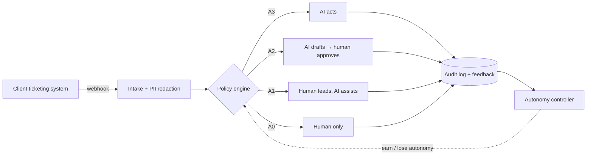

# Human+AI Operating Model

[](https://github.com/subramani9000/human-ai-operating-model/actions/workflows/ci.yml)

**A simulated forward-deployed engineering (FDE) engagement:** designing and building the operating model that decides, for every piece of enterprise work, *whether AI or a human does it, at what level of autonomy, under whose ownership, and how that changes as evidence comes in.*

The client, **Kaveri Logistics**, is fictional. The problems are not: three disconnected AI pilots, a chatbot that closes tickets nobody reviewed, an audit team that can't get a log, and service-desk agents who don't trust any of it.

> 📄 Start with the [problem statement](docs/00-problem-statement.md), then the [discovery notes](docs/01-discovery-notes.md).

---

## The idea in one picture



| Level | Meaning | Example |
|---|---|---|
| **A3** | AI acts on its own | Password reset on SSO |
| **A2** | AI drafts, a human approves | Anything touching payroll (permanent cap) |
| **A1** | Human leads, AI assists with context | App errors escalated to L2 |
| **A0** | Human only | Phishing reports, site outages |

The operating model is **code**: [`policy/autonomy.yaml`](policy/autonomy.yaml) defines levels, caps, owners and rules. Every decision records the policy version that produced it. Autonomy is **earned**: a category is promoted only when its measured precision clears the bar *and* its named human owner approves. It is demoted automatically the moment quality drops.

---

## Status

| Phase | Scope | Status |
|---|---|---|
| **1. Discovery and foundations** | Engagement docs, synthetic messy dataset, mock ServiceNow-style API, data model, validated policy | ✅ Done |
| **2. Intake** | Ticketing adapter, idempotent webhook receiver, PII redaction, keyword + Claude classifiers, golden-set evals | ✅ Done |
| **3. Policy engine + audit** | Monotone autonomy decisions with explanations, tripwires, property tests, hash-chained audit log, policy simulation | ✅ Done |
| **4. Agent lanes** | Playbooks, guarded tools, drafts with guardrails, handoff packets, review console, QA sampling | ✅ Done |
| **5. Learning loop** | Reopen feedback, autonomy controller, leadership dashboard, 28-day pilot simulation | ✅ Done |
| 6. Hardening | SSO, unreviewed-draft sweep, CI eval gates, tracing, runbook | ⏳ Next |

See [docs/roadmap.md](docs/roadmap.md) for details.

---

## Quickstart

```bash
git clone https://github.com/subramani9000/human-ai-operating-model.git
cd human-ai-operating-model
pip install -e ".[dev]"

hao policy validate      # check the operating-model policy
hao generate             # 5,000 synthetic tickets + ground-truth labels (seed 42)
hao profile              # data-quality profile of the dataset
pytest -q                # 157 tests (incl. property-based safety invariants and end-to-end lanes)
hao eval redaction       # PII leakage report
hao eval classify --golden hard_v1   # keyword baseline on hand-written tickets
hao policy simulate --promote password_reset=A3   # what would a promotion do?
hao audit verify         # walk the tamper-evident audit chain
hao controller status    # per category: policy vs effective level, evidence, proposals
hao pilot simulate       # 28 days × 200 tickets through the whole system (~10 min)
```

### Run the end-to-end flow

```bash
hao mock serve                 # terminal 1: simulated client ticketing system  → :8001/docs
hao platform serve             # terminal 2: our platform (webhooks → lanes)   → :8002/console
hao platform subscribe         # terminal 3: register the webhook
curl -X POST localhost:8001/api/now/table/incident -H 'X-API-Key: kaveri-dev-key' \
  -H 'Content-Type: application/json' \
  -d '{"short_description": "Password reset request for SSO",
       "description": "My SSO password expired over the weekend. Kindly reset it.",
       "caller_id": "Priya Raman", "caller_email": "priya.raman@kaveri.example", "priority": "3"}'
```

Password reset is at **A2**, so the platform triages it, plans the actions from its playbook, drafts a reply and waits:

```
[AI triage · keyword-v1] category: password_reset · application: SSO · confidence 0.95
Autonomy: A2 (AI drafts, human approves). category default.
Accountable owner: Priya Nair · suggested group: SD-L1 · policy 2026.11-pilot (c17c371b2e93)
[AI draft · awaiting approval] http://localhost:8002/console/items/1
Planned actions: identity.reset_password, customer.reply, incident.resolve
```

Open **http://localhost:8002/console**, approve it, and the actions run under the reviewer's name: the client's IAM resets the password (credential sent by SMS, never seen by the AI), the user gets the reply, and the ticket is resolved:

```
comment  user:priya.nair@kaveri.example | Hi Priya Raman, we've reset your SSO password. A temporary password…
state 6  | Password reset via IAM; temporary password delivered by SMS. KB0010001
```

`GET localhost:8002/decisions/<sys_id>` returns the decision, every policy step behind it, and its audit trail. Edit any audit row in the database and `hao audit verify` reports exactly which event was changed.

| Level | What the platform does |
|---|---|
| **A0** | Nothing beyond the triage note. A human owns it end to end |
| **A1** | Routes to the right group and posts a **handoff packet**: summary, KB article, similar tickets, next step |
| **A2** | Plans actions **from the playbook**, drafts the reply, waits in the review console; runs under the approver's name |
| **A3** | Executes the playbook as the agent; a sample goes to **QA review** |

Anything unexpected (no playbook, software not in the catalogue, a draft failing its guardrails, a tool error) falls back to the A1 handoff packet and never to more autonomy ([ADR 0008](docs/adr/0008-agent-lanes-and-tools.md)).

To use Claude, set `ANTHROPIC_API_KEY` in `.env` and run `hao platform serve --classifier claude --drafter claude`.

Or with Docker (Postgres + both services): `docker compose up --build`

### Talk to the mock client system

```bash
H='X-API-Key: kaveri-dev-key'

# Load the synthetic backlog
curl -X POST localhost:8001/admin/seed -H "$H"

# ServiceNow-style encoded queries
curl -G localhost:8001/api/now/table/incident -H "$H" \
  --data-urlencode 'sysparm_query=assignment_group=HR-Systems^ORDERBYDESCopened_at' \
  --data-urlencode 'sysparm_limit=5'

# Subscribe to signed webhooks
curl -X POST localhost:8001/api/x_kaveri/webhooks -H "$H" \
  -H 'Content-Type: application/json' -d '{"url": "http://localhost:9000/hooks"}'

# Try to resolve without close notes and watch the data policy reject it
curl -X PATCH localhost:8001/api/now/table/incident/<sys_id> -H "$H" \
  -H 'Content-Type: application/json' -d '{"state": "6"}'
```

---

## What makes this realistic

**The mock client system is deliberately not clean** ([ADR 0002](docs/adr/0002-integrate-not-replace.md)):

- Every field is a string (`"true"`, `"3"`, `""`), datetimes have no timezone, responses are wrapped in `{"result": ...}`
- Resolving requires `close_code` and `close_notes` (data policy), and closed tickets are immutable
- **Unknown fields are silently ignored.** Misspell `assignment_group` and nothing tells you
- Webhooks are HMAC-signed, retried with backoff and **at-least-once** (`MOCK_WEBHOOK_DUPLICATE_RATE`)
- Injectable outages and latency (`MOCK_FAILURE_RATE`, `MOCK_LATENCY_MS`)

**The synthetic data reproduces what discovery found on the floor** ([ADR 0003](docs/adr/0003-synthetic-data-first.md)):

```
Data quality (what the AI has to cope with):
  user category blank         39.9%
  user category 'Other'       19.0%
  needs re-routing            62.5%
  contains PII                59.4%
Style mix: formal 45.2%, terse 24.4%, tanglish 13.3%, hinglish 10.0%, angry 7.1%
```

Tickets like *"WMS-Pro open panna 'Scanner sync failed: code WMS-4021' nu error varudhu"*, forwarded email chains, signatures with phone numbers and employee IDs, and near-duplicates from impatient callers. Ground-truth labels live in a **separate file** so evals never leak into the system under test.

**The evals are designed to catch their own blind spots** ([ADR 0005](docs/adr/0005-classifier-evaluation.md)):

| Keyword baseline on… | Accuracy | Risk-downgrade errors |
|---|---|---|
| `golden_v1`: 300 synthetic tickets | 94.7% | 14 |
| `hard_v1`: 45 hand-written tickets, incl. prompt injection | **26.7%** | 5 |

Synthetic data flatters whoever wrote the generator, so every classifier is measured on both sets. The headline metric is **risk-downgrade errors** (for example, a payroll ticket read as a password reset), because those are the errors that would route high-risk work to a low-risk autonomy lane. See [eval reports](docs/eval-reports/).

**The policy can't be configured into something unsafe.** Validation rejects a payroll category set to A3, a category without a named owner, or controller thresholds that would make autonomy flap. Every engine step can only *lower* autonomy, and property-based tests check the safety invariants against the **most permissive policy the validator allows** ([ADR 0006](docs/adr/0006-policy-engine-semantics.md)). `hao policy simulate` shows what a policy change would do before anyone approves it:

| Keyword classifier on `golden_v1` | Over-autonomy (dangerous) | Under-autonomy (lost automation) |
|---|---|---|
| Rules off | 8 | 1 |
| Current policy (confidence rules + tripwires) | **1** | 129 |

**Every AI decision is auditable.** Events are hash-chained and the head hash is anchored outside the database. Edits, deletions and full rewrites are all detected ([ADR 0007](docs/adr/0007-hash-chained-audit-log.md)).

**Autonomy is earned, and lost, from evidence** ([ADR 0010](docs/adr/0010-autonomy-controller.md)). Every approve, edit, reject, QA verdict and user reopen becomes evidence. Demotion is automatic (a runtime cap, no deploy). Promotion is only *proposed*: the named category owner applies it, which edits `autonomy.yaml` for a PR. The [simulated 28-day pilot](docs/pilot-readout-simulated.md) runs 5,600 tickets through the real system with simulated reviewers and users:

| Day | What happened |
|---|---|
| 3 | Controller proposes `password_reset` A2 → A3 (100% over 61 reviewed drafts) |
| 5 | Priya Nair (owner) approves; `account_unlock` proposed |
| 7 | `account_unlock` promoted |
| 14 | `how_to_question` promoted (95.5% over 67) |
| 28 | 442 tickets resolved by AI alone, 855 drafts approved, 3.5% reopen rate, ~144 human hours redirected (est.) |

It also **missed the 35–40% A3 target** (7.9%; 10.5% once all promotions landed) and says why. Of tickets in promoted categories, 39% were held back by *policy*: password resets on medium-risk apps like KLMS are capped at A2. Another 30% were held back by classifier confidence. And only 4 categories have playbooks. Each gap has a different owner. The first two simulation runs also caught two controller design bugs that unit tests didn't (a demotion with no way back, and a sampling-bias error). Both are written up in ADR 0010.

The **leadership dashboard** (`localhost:8002/dashboard`) shows the same view live: pilot targets, level mix, outcomes, override and reopen rates, and human hours redirected with its assumptions (`policy/value.yaml`).

---

## Repository layout

```
docs/                     The engagement trail: problem, discovery, stakeholders, design, ADRs, journal
policy/                   autonomy.yaml (levels, caps, rules, controller) · ownership.yaml · taxonomy.yaml ·
                          playbooks.yaml (allowed actions) · value.yaml (dashboard assumptions)
src/hao/
  synthetic/              Deterministic messy-ticket generator + noise model
  mock_ticketing/         ServiceNow-style client API, signed webhooks, chaos injection
  adapters/               TicketingAdapter protocol + ServiceNow adapter (retries, typed, read-after-write)
  platform/               Webhook receiver, intake pipeline, review console
  agents/                 Lanes, playbooks, guarded tools, BM25 retrieval, drafters + guardrails
  intake/                 PII redaction, taxonomy, keyword + Claude classifiers
  evals/                  Golden sets, redaction eval, classification eval
  policy/                 Policy schema + validation, decision engine, simulation
  audit/                  Hash-chained, tamper-evident audit log
  controller/             Autonomy controller: evidence → demotions and promotion proposals
  dashboard/              Leadership metrics (HTML + JSON) against the pilot targets
  pilot/                  End-to-end pilot simulator with simulated humans
  db/                     Data model (client_* = simulated client, hao_* = platform)
  cli.py                  `hao` command
data/synthetic/           Committed 200-ticket sample (full set via `hao generate`)
data/golden/              golden_v1 (300 synthetic, stratified) and hard_v1 (45 hand-written)
tests/                    Generator, policy, API, adapter, redaction, classifiers, end-to-end
```

## FDE skills this project exercises

- **Discovery under conflict:** sponsor vs. audit vs. HR, resolved in the design rather than ignored ([discovery notes](docs/01-discovery-notes.md), [stakeholder map](docs/02-stakeholder-map.md))
- **Integrating with systems you don't own:** adapters, idempotency, signed webhooks, failure injection
- **Getting unblocked:** synthetic data with exact ground truth while legal reviews historical data
- **Governance as engineering:** policy-as-code, named owners, auditable decisions
- **Evaluating honestly:** a second, hand-written eval set and metrics weighted by harm, not just accuracy
- **Building safe LLM integrations:** redaction before the model, forced structured output, prompt-injection handling, fail-safe defaults
- **Human-in-the-loop that people trust:** the LLM writes words and reviewed playbooks pick the actions; approvals re-check policy and run under the approver's name; the client's own IAM is a second lock
- **Evidence-driven autonomy:** evals and human verdicts decide what AI is allowed to do; owners sign promotions
- **Testing the system, not just the parts:** a pilot simulator that found two design bugs every unit test passed

Lessons learned along the way are in the [FDE journal](docs/fde-journal.md).

## License

MIT
