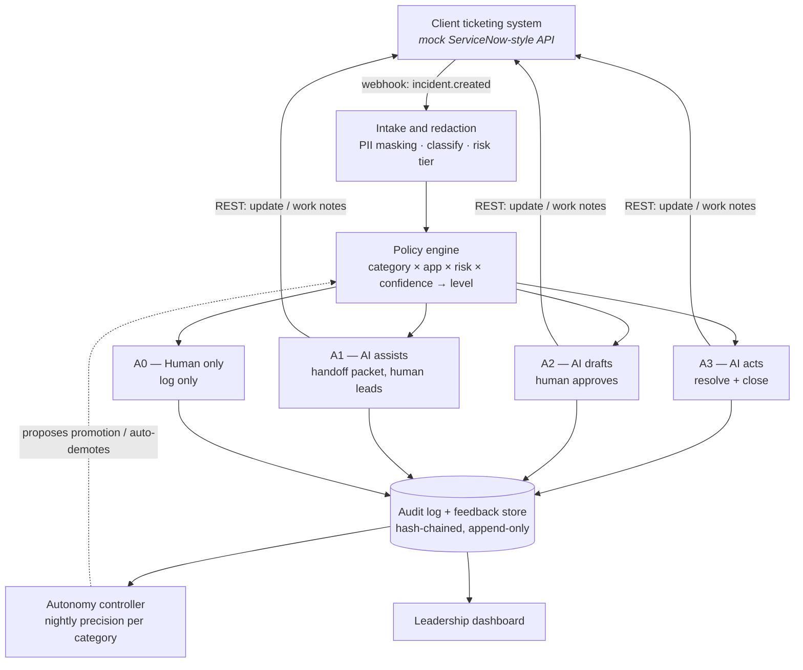
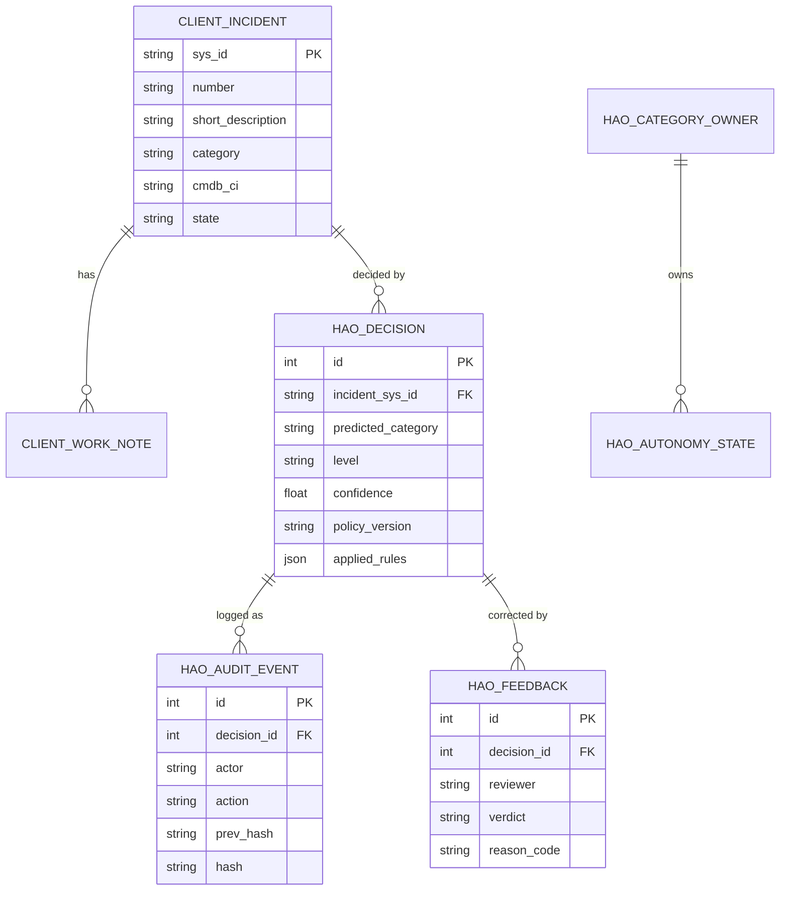

# 03 — Solution design

## Principle

**The operating model is code.** Kaveri's decision rights (who does what, at what autonomy, owned by whom) live in versioned policy files. Every ticket passes through that policy before AI or a human touches it, and every decision is logged against the policy version that produced it.

## Architecture

## Autonomy levels

| Level | Name | AI does | Human does | Typical categories |
|---|---|---|---|---|
| **A3** | AI acts | Resolves, writes close notes, closes | Samples for QA | Password reset, how-to |
| **A2** | AI drafts | Drafts resolution / action | Approves, edits or rejects with reason code | Software install, finance/HR (capped) |
| **A1** | AI assists | Builds the handoff packet: summary, similar tickets, checks done, suggestion | Leads the resolution | App errors, VPN edge cases |
| **A0** | Human only | Logs only | Everything | Security incidents, major outages |

### How a level is chosen (Phase 3)

1. Start from the category's `current_level` in `policy/autonomy.yaml`.
2. Apply the **application cap**: a ticket touching `FinCore` or `PeopleDesk` can never exceed A2, whatever its category.
3. Apply **rules** in order, e.g. classifier confidence < 0.80 drops one level; a VIP requester caps at A1; P1 priority caps at A0.
4. Clamp to `max_level`.
5. Record the decision with `policy_version`, the applied rules and inputs. **No decision without a policy reference.**

### How autonomy changes (Phase 5)

- **Promotion** is *proposed* by the controller when a category reaches ≥ 95% precision over ≥ 50 reviewed samples in a rolling 14-day window. The category owner approves it as a policy PR. Humans govern the AI's governance.
- **Demotion** is *automatic and immediate* when precision drops below 90% or a severity-1 incident is linked to an AI action. The owner is notified.

## Components and phases

| Component | Phase | Notes |
|---|---|---|
| Mock ticketing API (client system) | **1** ✅ | ServiceNow-style REST, signed webhooks, injectable failures |
| Synthetic messy dataset + ground-truth labels | **1** ✅ | Mirrors discovery findings; deterministic by seed |
| Data model + policy schema/validation | **1** ✅ | SQLAlchemy models; Pydantic-validated YAML |
| Ticketing adapter + webhook receiver (idempotent, loop-safe) | **2** ✅ | `src/hao/adapters`, `src/hao/platform` |
| Intake: context-aware redaction + classifier | **2** ✅ | Keyword baseline + Claude Haiku 5.5; golden-set evals ([ADR 0004](adr/0004-context-aware-redaction.md), [0005](adr/0005-classifier-evaluation.md)) |
| Policy engine + hash-chained audit log | 3 | |
| Agent lanes (LangGraph), review console | 4 | Claude Sonnet 5.5 for resolution and handoffs |
| Feedback loop, autonomy controller, dashboard | 5 | |
| Docker, CI eval gates, Langfuse, runbook, pilot readout | 6 | |

## Key data entities

Tables prefixed `client_` belong to the simulated client system. Tables prefixed `hao_` belong to our platform. In a real deployment they'd live in separate databases; here they share one for simplicity, but **no platform code writes to `client_` tables directly**. All changes go through the ticketing REST API, exactly as they would in production.
